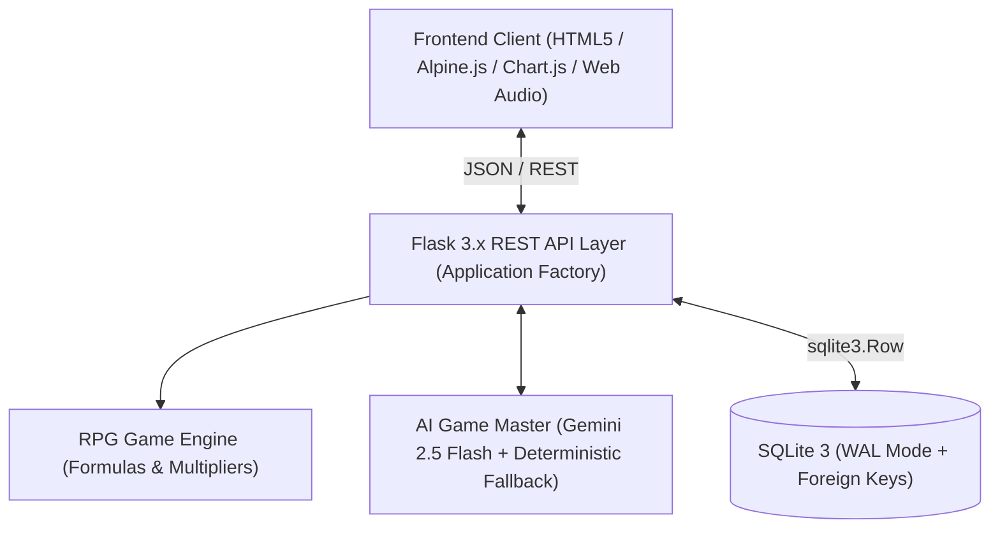

# The Seven-Phase Ascension — Architecture & Cultivation Reference

This document provides a comprehensive architectural specification, mathematical reference, and API registry for **The Seven-Phase Ascension** (Daoist Cultivation & Wuxia Sanctuary Edition).

---

## 1. System Topology



---

## 2. Mathematical Progression & Formula Matrix

### A. Realm Level Threshold
The total Qi ($XP$) required to reach Cultivation Level $L$ is given by:
$$XP(L) = \begin{cases} 0, & \text{if } L \le 1 \\ \lfloor 100 \times (L - 1)^{1.5} \rfloor, & \text{if } L > 1 \end{cases}$$

For any accumulated $total\_xp$:
$$L = \max \{ l \in \mathbb{N} \mid XP(l) \le total\_xp \}$$

### B. Four Pillars Sub-Level Curves
Each of the 4 Pillars (`MIND`, `HEALTH`, `CAREER`, `WEALTH`) scales independently using:
$$SubXP(S) = \begin{cases} 0, & \text{if } S \le 1 \\ \lfloor 50 \times (S - 1)^{1.4} \rfloor, & \text{if } S > 1 \end{cases}$$

### C. The 7 Ascension Phases (Realm Tiers)
| Realm Tier | Level Range | Classical Realm Title | Wuxia English Epithet |
|---|---|---|---|
| **Phase I** | $1 - 4$ | 炼气期 (Lian Qi) | Phase I: The Dormant Initiate |
| **Phase II** | $5 - 9$ | 筑基期 (Zhu Ji) | Phase II: The Awakened Seeker |
| **Phase III** | $10 - 16$ | 金丹期 (Jin Dan) | Phase III: The Crucible Adept |
| **Phase IV** | $17 - 24$ | 元婴期 (Yuan Ying) | Phase IV: The Astral Vanguard |
| **Phase V** | $25 - 34$ | 化神期 (Hua Shen) | Phase V: The Grand Sovereign |
| **Phase VI** | $35 - 49$ | 炼虚期 (Lian Xu) | Phase VI: The Eternal Paragon |
| **Phase VII** | $50+$ | 合体/飞升 (Fei Sheng) | Phase VII: The Transcendent Ascendant |

### D. Dynamic Archetype Calculations
Archetypes dynamically reflect the cultivator's highest attribute Qi, generating hybrid titles when the top two attributes are within 10% of each other:
$$\text{Difference Ratio} = \frac{XP_{\text{top1}} - XP_{\text{top2}}}{XP_{\text{top1}}} \le 0.10$$

- **Pure Titles**:
  - `MIND` $\rightarrow$ *Astral Savant*
  - `HEALTH` $\rightarrow$ *Titan Vanguard*
  - `CAREER` $\rightarrow$ *Grand Architect*
  - `WEALTH` $\rightarrow$ *Sovereign Alchemist*
- **Hybrid Titles**:
  - `MIND` + `CAREER` $\rightarrow$ *Arcane Architect*
  - `MIND` + `HEALTH` $\rightarrow$ *Psionic Juggernaut*
  - `MIND` + `WEALTH` $\rightarrow$ *Mystic Merchant*
  - `HEALTH` + `CAREER` $\rightarrow$ *Iron Forgemaster*
  - `HEALTH` + `WEALTH` $\rightarrow$ *Dread Tyrant*
  - `CAREER` + `WEALTH` $\rightarrow$ *Empire Magnate*

### E. Streak Multiplier & Chronos Aegis
- **Daily Streak Bonus**:
  $$\text{Multiplier} = 1.0 + \min(0.50, \text{streak} \times 0.05)$$
- **Preservation Talisman (Chronos Aegis)**: If days missed $> 1$ and $\text{shields} > 0$, one shield is consumed, the streak is preserved and incremented, and no decay occurs.

---

## 3. REST API Registry

| Endpoint | Method | Input Payload | Output / Side Effect |
|---|---|---|---|
| `/` | `GET` | None | Renders light Wuxia SPA dashboard. |
| `/api/hud` | `GET` | Optional `X-Simulation-Date` | Returns complete user stats, levels, active campaigns, daily deeds, 14d velocity & radar data. |
| `/api/campaign` | `POST` | `goal_title`, `description`, `difficulty_focus`, `target_date` | Generates thematic Tribulation Boss & splinters goal into 5–6 deeds. |
| `/api/quests` | `POST` | `task_name`, `attribute_type`, `difficulty_rank`, `campaign_id` | Inscribes a standalone or campaign deed for today. |
| `/api/complete_quest/<id>` | `POST` | Optional `X-Simulation-Date` | Deals Boss damage, awards Qi + Spirit Stones with streak multiplier, checks realm advancement. |
| `/api/crucible/complete` | `POST` | `duration_minutes`, `attribute_type`, `campaign_id` | Logs meditation minutes, delivers critical strike to Tribulation, awards bonus Qi. |
| `/api/journal` | `POST` | `journal_content` | Analyzes sentiment, detects blockers, awards reflection Qi, saves chronicle entry. |
| `/api/reliquary/buy/<id>` | `POST` | None | Purchases item, grants Chronos Shield if talisman, decrements Spirit Stones. |
| `/api/reliquary/create` | `POST` | `item_name`, `item_description`, `gold_cost`, `icon_name`, `item_type` | Inscribes a custom mortal realm reward. |
| `/api/oracle/prophecy` | `POST` | `inject_quests` (bool) | Strategic weekly review via Astrolabe, optionally injects balance practices. |

---

## 4. Verification & Simulation Log

```
Test Suite Execution: pytest tests/test_api.py
Status: 12 passed in 0.84s (100% Pass Rate)

100-Day Simulation: python tests/simulate_100_days.py
Status: 100 days simulated with human variance and rest periods.
- Final Level: 32 (Assertion: 22 <= L <= 35) -> PASS
- Final Ascension Phase: Phase V (Assertion: Phase >= 4) -> PASS
- Tribulations Defeated: 5 (Assertion: Bosses >= 3) -> PASS
- Final Spirit Stones: 4,050 (Assertion: Non-negative) -> PASS
- Chronos Shields Consumed: 7 (Streak Protection Verified) -> PASS
- Database Locks or Exceptions: 0 -> PASS
```
